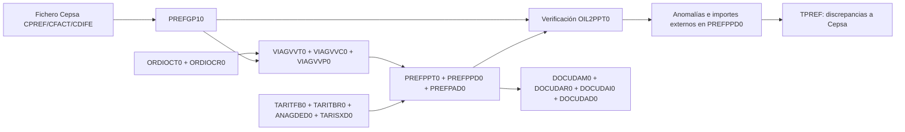

# Informe técnico de la facturación de Cepsa en RES/OIL 2

Fecha del análisis: 8 de octubre de 2026.

## 1. Alcance y grado de certeza

He seguido el circuito de Cepsa en el código fuente activo de los proyectos `Client/RESOIL21.vbp` y `Logic/OIL2BLG1.vbp`: importación de propuestas, enlace con pedidos y entregas, valoración propia, comparación, tratamiento de diferencias, generación de documentos y salida de discrepancias. La carpeta también contiene copias históricas, formularios binarios `.frx`, informes Crystal Reports `.rpt`, ejecutables y librerías. Esos artefactos no describen de forma legible todo su comportamiento.

El repositorio **no incluye DDL, migraciones, copia de la base de datos ni diccionario de datos**. Por tanto, los nombres y significados de columnas de este informe proceden de las clases VB6 y de las consultas SQL. No se puede afirmar con esta evidencia el tipo SQL exacto, la precisión real, las claves primarias, índices, claves externas, valores por defecto, disparadores, procedimientos almacenados ni todas las columnas físicas que puedan existir. Los parámetros de `.Add` indican tipos y longitudes usados por la aplicación, no prueban el esquema físico.

El fichero adjunto `inventario-campos-referenciados.csv` recoge **1.409 declaraciones de campo, de 100 tablas, en 109 clases activas** del proyecto Logic, con clase y número de línea. Puede haber varias declaraciones del mismo campo en clases de entidad y selección. Quedan fuera de ese CSV las columnas solo citadas en SQL y las familias construidas dinámicamente, como los quince tramos de `TARITBR0`. Es un inventario del código, no un esquema completo de la base de datos.

### Fuentes principales

| Pieza | Archivo y ubicación | Función |
|---|---|---|
| Identificadores y menú | `Client/OIL2GLOBAL.bas:57-66,257-264,1302-1313,1405-1407` | Enruta formularios y fija Cepsa=`038`, CLH=`901`, transportista Cepsa=`041883`. |
| Entrada Cepsa | `Client/frmGP1ImportCEPSA.frm:372-1110` | Lee el fichero, transforma campos, inserta `PREFGP10` y actualiza entregas. |
| Propuesta externa | `Logic/CPrefatturaSoc.cls:37-369`, `CPrefatturaSocSelezione.cls:73-226` | Campos, búsqueda, borrado e importes externos. |
| Valoración interna | `Client/frmPPTCreate.frm:764-2170` | Crea cabecera, líneas y cargos de prefactura; aplica reglas de Cepsa. |
| Tarifas | `Logic/CTariffaBinomica.cls:76-488`, `CTariffaBinomicaRiga.cls:63-478` | Busca tarifa vigente y calcula importe. |
| Conciliación | `Client/OIL2PPT0.frm:911-1665` | Compara Cepsa con la valoración interna, marca anomalías y permite ajustar importes. |
| Detalle | `Logic/CPrefatturaDettaglio.cls:44-513` | Escribe importes externos e internos y mantiene la máscara de anomalías. |
| Discrepancias | `Client/frmGP1ExportCEPSA.frm:768-1577` | Construye fichero `TPREF...` con los importes reclamados. |
| Facturas | `Logic/CPrefattura.cls:117-925`, `CDocumentoAmministrativo.cls:107-280`, `Client/DAMSelect2Z27.frm:1330-1430` | Agrupa cargos, crea documentos, calcula IVA y cambia estados. |

## 2. Qué significa «facturación de Cepsa» en esta aplicación

Hay tres objetos distintos que conviene no mezclar:

1. **Propuesta o prefactura recibida de Cepsa**, en `PREFGP10`: reproduce importes y referencias del fichero externo (`CPREF`, `CFACT` o `CDIFE`).
2. **Valoración propia**, en `PREFPPT0` (cabecera), `PREFPPD0` (una línea por descarga valorada) y `PREFPAD0` (cargos imputables). En `PREFPPD0` se conservan simultáneamente importes internos y externos.
3. **Factura administrativa**, en `DOCUDAM0` (cabecera), `DOCUDAR0` (líneas), `DOCUDAI0` (IVA) y `DOCUDAD0` (vínculo documental con los cargos). Su destinatario se toma de `PADIDACL`; sin datos reales no debe suponerse que siempre sea la sociedad Cepsa.

La aplicación es VB6 de escritorio. `Client` contiene formularios y lectura de ficheros; `Logic` contiene clases de entidad, consultas SQL y reglas de negocio; `Objects` contiene binarios COM; `Reports` contiene informes Crystal. La conexión y las transacciones pasan por `CDataStruct` y `DataConnect.DA`. Hay SQL propio de SQL Server (`CONVERT`, `DATEPART`, `LEN`, `MONTH`, `YEAR`) y dependencias COM externas declaradas en los `.vbp`.

## 3. Entrada del fichero de Cepsa

### 3.1 Selección y lectura

`frmGP1ImportCEPSA.OpenTextFile` abre un fichero de texto, lee cada línea con `Line Input`, llama a `CTextFile.ParseFixedLenFields(...,1,34)` y guarda sus 34 valores en una matriz para la importación. No hay una validación explícita del tamaño exacto de la línea: `ParseFixedLenFields` extrae con `Mid$` los segmentos disponibles. `CTextFile` define también la salida: texto alineado a la izquierda y numéricos formateados con ceros a la izquierda (`Client/CTextFile.cls:135-163,248-283`).

La longitud nominal del registro según las 34 declaraciones es **354 caracteres**. La posición física sigue el orden de llamada a `.Add`, no el número lógico de la clave. El campo lógico **34, «Servicios exentos», está físicamente entre los campos 28 y 29** tanto en el importador como en el exportador de discrepancias. Hay que respetar ese orden al construir o interpretar un fichero.

| Campo lógico | Longitud | Significado y destino principal |
|---:|---:|---|
| 1 | 6 | Transportista externo; `GP1RIAVE` y selección de ente emisor. |
| 2 | 8 | Fecha AAAAMMDD; `GP1DTCON`. |
| 3 | 6 | Tipo de servicio; `DESVIO` pasa a `GP1FLTIS=D`, el resto a `N`. |
| 4 | 2 | Tipo de entrega; participa en la búsqueda del pedido. |
| 5 | 1 | Estado del registro del fichero; se lee, sin asignación visible en `RecordToGP1`. |
| 6 | 4 | Código externo de depósito; se traduce a `GP1IDADE` y se conserva en `GP1RIADE`. |
| 7 | 12 | Unidad de transporte Cepsa; se normaliza para buscar `GP1IDAUT` y se conserva en `GP1RIAUT`. |
| 8 | 3 | Unidad de transporte del depósito; `GP1RIDUT`. |
| 9–10 | 15 cada uno | Matrículas tractora/cisterna; originales `GP1RIAM1/RIAM2`, códigos internos `GP1IDAM1/IDAM2`. |
| 11–12 | 7 y 14 | Código y NIF del conductor; `GP1RIAAU`, `GP1NIAAU`, código interno `GP1IDAU1`. |
| 13 | 5 | Número/secuencia de viaje Cepsa; `GP1NRVIA`. |
| 14–15 | 6 cada uno | Operador y suministrador; `GP1RIOPE`, `GP1RIFOR`. |
| 16 | 16 | Referencia de pedido Cepsa; `GP1RIOCT`, reducida al ancho de `GP1RIFE1` para búsquedas. |
| 17–18 | 12 y 15 | Referencia de entrega SAP y ticket; `GP1RIVVC`, `GP1RITIK`. |
| 19 | 9 | Producto externo; se usan sus cinco primeros caracteres para traducir a `GP1IDAPR`. |
| 20 | 15 | Destino externo; se transforma en código CLH `CP` + últimos ocho caracteres para `GP1IDADZ`. |
| 21 | 30 | Nombre de embarcación; `GP1NOMEB`. |
| 22–23 | 7 cada uno | Litros y kilos; `GP1QTSCA`, `GP1QTSKG`; también actualizan la descarga. |
| 24 | 4 | Distancia/radio externo; `GP1QKMRA`. |
| 25 | 2 | Tipo de tarifa; `BT` se convierte en `GP1FLTIT=B`. |
| 26 | 9 | Tarifa, dividida entre 1.000.000; `GP1TARAP`. |
| 27–28 | 10 cada uno | Importe y peaje, divididos entre 100; `GP1IMPOR`, `GP1IMPPE`. |
| 34 | 9 | Servicios exentos, divididos entre 1.000; `GP1IMSEX`. |
| 29 | 54 | Relleno del formato. |
| 30–31 | 10 cada uno | Canon de operario y servicio de buques, divididos entre 100; `GP1IMPOE`, `GP1IMPBE`. |
| 32 | 5 | Horas de servicios especiales, divididas entre 100; `GP1IMPHE`. |
| 33 | 10 | Importe de servicios especiales, dividido entre 100; `GP1IMPSE`. |

El fichero se clasifica por sus cinco primeras letras: `CPREF→P`, `CFACT→F`, `CDIFE→D`, guardado en `GP1FLTIR`. El año se extrae de los caracteres 12–15 del nombre y el mes de los 16–17; la raíz sin extensión se guarda en `GP1RIFAT`. El primer transportista de la matriz determina el ente: `002881` o `709704→004`, `054320→624` (`frmGP1ImportCEPSA.frm:424-455`).

### 3.2 Traducciones y enlace con la entrega

Se traducen depósitos, unidades de transporte, conductores y productos mediante tablas de correspondencia por sociedad. Las matrículas pierden el prefijo `ES` o `E` antes de buscar el vehículo. El destino se traduce contra la sociedad CLH (`901`). `GetConsegnaCEPSA` toma la referencia externa y consulta `ORDIOCT0`/`ORDIOCR0` unidos a `VIAGVVP0`/`VIAGVVC0`/`VIAGVVT0`. Para los tipos `910151`, `910152` y `910153` busca la referencia completa y luego un recorte; para los demás separa diez caracteres de pedido, tres de línea y dos de partición. Excluye registros anulados de las cinco tablas (`CPrefatturaSoc.cls:119-200,240-258`).

Cada línea inicia una transacción: inserta `PREFGP10`; si encuentra entrega, marca el viaje `C` cuando estaba `D` o `P` y actualiza `VIAGVVP0.VVPQCOLT`, `VVPQCOKG`, `VVPQTRLT` y `VVPQTRKG` con los litros y kilos recibidos. Para los tres tipos especiales también actualiza `ORDIOCT0.OCTRIFE1`. La función de actualización de cantidades se ve en `CViaggioProdotto.cls:309-345,378-388`. Un error de enlace o de actualización de entrega conserva la línea de `PREFGP10` y la marca como fallida en el log; un error de inserción la revierte (`frmGP1ImportCEPSA.frm:539-599`). Antes del bucle, `DeletePrefCEPSA` elimina los registros Cepsa de tipo `P` del mismo mes/año de fecha de entrega y ente emisor.

## 4. Valoración interna

`frmPPTCreate` es el formulario que el menú identifica para AGIP/Cepsa (`fcPPTCREA`). Selecciona descargas de viajes completados `C`, no anulados, ordenadas por viaje y entrega. Para valoración pasiva `P` también admite viajes `E` y filtra el transportista según ente (`CViaggioSelezione.cls:416-442`). Al iniciar crea `PREFPPT0` con periodo, descripción, tipo `A` activo o `P` pasivo y sociedad. Procesa una transacción por viaje; inserta `PREFPPD0` y, cuando hay importe, `PREFPAD0`. En valoración activa pasa el viaje a estado `E` al finalizarlo (`frmPPTCreate.frm:1179-1284,2117-2169`).

Para Cepsa (`038`) prepara la referencia externa añadiendo línea de tres cifras y partición de dos, salvo pedidos `EA`/`O`. Un evento de devolución `011` sustituye la cantidad descargada por la cargada. Usa la modalidad de tarifa binómica `B`, toma el contrato de la unidad de transporte y busca la tarifa vigente por depósito, fecha, tipo activo/pasivo, sociedad, ente, tipología, destino, cisterna y transportista/vehículo cuando aplica. Primero intenta la cisterna específica y luego una tarifa sin ese filtro (`frmPPTCreate.frm:1345-1420`, `CTariffaBinomica.cls:76-280`).

La distancia procede de `ANAGDED0`: `DEDKMATT` para activa, `DEDKMPAS` para pasiva; si no hay registro se usa `ANAGADZ0.ADZKMRAG`. Se consulta el total de entrega, destino, pedido y viaje. Si faltan kilos, se calculan con litros × `ANAGAPR0.APRDECON`, formateando a entero. La tarifa se elige primero por intervalo de kilómetros y luego por tramo de cantidad, hasta quince tramos. Para producto de tipología `020`/`040` se aplican **23.000 kg mínimos** si los kilos son inferiores. La rama normal calcula `round((kg/1000 × tarifa) + (kg/1000 × km × tarifaDistancia), 2)`; la kilométrica factura solo en la última descarga y usa `km × tarifaDistancia`, con regla especial para el transportista `A10` cuando km≤300 (`CTariffaBinomicaRiga.cls:63-316`).

El cálculo también contiene excepciones de negocio: menudeo `LM` para entregas pequeñas (límite 4.950 L en ciertos depósitos catalanes y 9.500 L en otros), tarifa `CE` para depósito `260` (Ceuta), tratamiento de Canarias `REC` y fuel de tipología `020`, y tarifas específicas `LMT`, `LME`, `L15`, `L16`, `CAT` según ente y depósito (`frmPPTCreate.frm:1664-1789`). La búsqueda alternativa usa `TARITFA0`/`TARITFR0`.

Los servicios especiales salen de `TARISXD0` por destino y vigencia. `L` y `K` indican base en miles de litros o kilos; los códigos `OB` y `TO` suman canon portuario, `BP` aplica bombeo, `SE` servicio especial y `SV` paralización. Para `BP` se cuentan las entregas del destino y puede consultarse `B3` como excepción al mínimo de tres, con exclusión distinta para productos `020`/`040` (`frmPPTCreate.frm:1597-1665`). El peaje interno se toma de un valor manual o de distancias de destino y se prorratea entre descargas del viaje (`frmPPTCreate.frm:1270-1310`).

Finalmente `RowToPPD` copia pedido, viaje, cantidades, sociedad, destino, producto y resultado interno a `PREFPPD0`. El cargo principal `001` guarda cliente, contrato `3` para Cepsa, número de entregas, km, litros, tarifa e importe en `PREFPAD0`. En valoración pasiva hay un cargo festivo `013` con importes fijos 36,05 o 36 según transportista y ente (`frmPPTCreate.frm:877-1013,1894-2008`).

## 5. Comparación y discrepancias

Al abrir una cabecera Cepsa, `OIL2PPT0.DoCommand(fcOpen)` ejecuta `CheckPrefattureCEPSA` (`OIL2PPT0.frm:1746-1787`). Busca las líneas de `PREFGP10` por referencia externa y depósito; si falta la referencia, usa fecha, producto, destino y unidad de transporte. Desde un cambio fechado en 2017, suma las líneas encontradas de `CFACT` y `CDIFE` para tarifa, importe, peaje y servicios. Copia a `PREFPPD0` tarifa, importe, km, cantidades y servicios externos mediante `AddExtData`, y guarda el código de anomalía en `PPDFLANO`. Tras cada línea cambia `VIAGVVT0.VVTFLST5` a `T` (`OIL2PPT0.frm:911-1207`).

`AnomalyCheckCEPSA` compara fecha, destino, unidad, km, importe, transportista, matrículas, unidad del depósito, NIF, secuencia, tarifa, canon, buques, horas/importe de especiales, exentos y peaje. El umbral absoluto para importes, servicios y peaje es **0,20**; tarifa, km y exentos se comparan directamente. El peaje solo se marca discrepante si el importe interno no es cero. Si no encuentra propuesta, marca `apPropostaNonTrovata` y `apPedaggio` (`OIL2PPT0.frm:1275-1473`).

### Máscara de anomalías de `PREFPPD0.PPDFLANO`

| Bit | Nombre en código | Lectura funcional |
|---:|---|---|
| 1, 2, 4, 8, 16, 32 | `apDiffQuantita`, `apDiffKm`, `apTariffaMinima`, `apDatiDiscordanti`, `apPropostaNonTrovata`, `apDiffImporto` | Cantidad, km, mínimo, datos, ausencia de propuesta e importe. |
| 64, 128, 256, 512, 1.024 | `apVettore`, `apData`, `apTipoServizio`, `apUnitàDiTrasporto`, `apVeicoloPerDeposito` | Identificación y condiciones operativas. |
| 2.048, 4.096, 8.192, 16.384, 32.768 | `apTargaMotrice`, `apTargaRimorchio`, `apCodiceAutista`, `apCodFiscAutista`, `apProgressivoViaggio` | Vehículos, conductor y secuencia. |
| 65.536, 131.072, 262.144, 524.288, 1.048.576 | `apCodiceDestinatario`, `apNomeImbarcazione`, `apTipoTariffa`, `apTariffa`, `apPedaggio` | Destino y conceptos tarifarios. |
| 2.097.152, 4.194.304, 8.388.608 | `apDataGradoServizio`, `apServOperarioBunker`, `apServBuquesPuerto` | Fecha y servicios portuarios. |
| 16.777.216, 33.554.432, 67.108.864 | `apServOreServSpeciali`, `apServImpServSpeciali`, `apServImpServEsenti` | Horas e importes especiales y exentos. |

Hay dos vías de ajuste. `ForzaImporti` copia `PPDIMPVA` a `PPDIMPVI` cuando el externo es mayor y ajusta la máscara; `FuerzaImporte` incrementa, por comparación con Cepsa, importe, tarifa, peaje y servicios internos, y también corrige diferencias positivas inferiores a 0,02 (`CPrefattura.cls:650-656`, `OIL2PPT0.frm:1475-1665`). El propio formulario advierte que después se debe volver a verificar.

`frmGP1ExportCEPSA` selecciona detalles con anomalía distinta de cero y descarta viajes en estado de transmisión `D`. Puede filtrar diferencias de importes y/o peajes. Construye registros fijos con los mismos 34 campos lógicos: datos externos si existen en `PREFGP10`, si no datos internos y referencias de pedido/ticket. Convierte importes a céntimos, tarifa a millonésimas y exentos a milésimas; toma el importe interno reclamado. Genera primero un fichero temporal y, si se acepta su salida, uno `TPREF{transportista}{año}{mes}{secuencia}.txt` con numeración de `ANAGANU0`. Marca el viaje con transmisión `D` tras escribir la línea (`frmGP1ExportCEPSA.frm:768-1577`).

## 6. De prefactura a factura

`OIL2PPT0.DoCommand(fcExport)` llama a `CPrefattura.CreateDocumento`. Esta busca contratos de `PREFPAD0`, consulta `ANAGACN0` y `ANAGAMF0` para decidir agrupación y crea un documento por cliente/contrato, separando por depósito o por código de cargo según `AMFFLROF` (`CPrefattura.cls:117-388`). La cabecera `DOCUDAM0` nace con tipo `FAT`, número visible `PROV`, estado `G`, emisor de documento `001`, moneda y forma de pago del cliente. Cada grupo de cargos crea una línea `DOCUDAR0` con cantidad igual al **importe sumado** y precio unitario **1**. Se insertan trazas en `DOCUDAD0` y se actualizan `PADIDAEE/PADIDAND/PADIDDAM` en `PREFPAD0`.

`CDocumentoAmministrativo.ComputeTotali` agrupa las líneas por código IVA, consulta `ANAGAIV0.AIVALIQU`, recrea `DOCUDAI0` y calcula total e IVA de la cabecera. La prefactura pasa a estado `E`. En la pantalla de gestión de facturas `DAMSelect2Z27`, hacerla definitiva cambia el documento `G→S` y sustituye `PROV` por un número de `DOCUNDA0`; la función de estado usa claves fijas `sociedad=001`, `emisor=056`, `tipo=FAT` para ese contador. También existen estado `T` transmitido y anulación de facturas provisionales al devolver una prefactura a `G` (`CDocumentoAmministrativo.cls:107-174`, `CPrefattura.cls:710-925`, `DAMSelect2Z27.frm:1330-1430`).

## 7. Diccionario de tablas directamente implicadas

Los campos que siguen son los **observables en el circuito**. El CSV permite localizar la declaración individual y su longitud de aplicación.

### 7.1 `PREFGP10`: datos recibidos de Cepsa

Una fila representa una línea externa. La clase declara como identificadores de búsqueda `GP1RIFE1` y `GP1IDAPR`, aunque la unicidad física de la tabla no consta.

| Grupo | Campos y significado |
|---|---|
| Procedencia | `GP1IDASC` sociedad (Cepsa `038`); `GP1IDAEE` ente emisor; `GP1FLTIR` tipo de fichero (`P/F/D`); `GP1RIFAT` nombre base de fichero; `GP1ANNOE` año; `GP1ANNUL` baja lógica; `TIMESTMP` control de cambios. |
| Enlace | `GP1RIFE1` referencia externa de búsqueda; `GP1RIFE2`, `GP1RIFE3` referencias adicionales; `GP1RIOCT` referencia completa de pedido; `GP1RIVVC` referencia de entrega; `GP1RITIK` ticket; `GP1DTCON` fecha de entrega; `GP1BOSCA` albarán/boleta; `GP1NRVIA` número externo de viaje. |
| Localización y servicio | `GP1IDAZO` zona interna; `GP1IDADE` depósito interno; `GP1RIADE` depósito externo; `GP1IDADZ` destino interno; `GP1RASDE` razón social del destino; `GP1NOMEB` embarcación; `GP1FLTIS` tipo servicio; `GP1RIOPE` operador; `GP1RIFOR` suministrador. |
| Transporte | `GP1IDAUT` unidad interna; `GP1RIAUT` código Cepsa; `GP1RIDUT` código del depósito; `GP1IDAM1/GP1IDAM2` vehículos internos; `GP1RIAM1/GP1RIAM2` matrículas externas; `GP1IDAU1` conductor interno; `GP1RIAAU` conductor Cepsa; `GP1NIAAU` NIF; `GP1RIAVE` código externo de transportista. |
| Magnitudes e importes | `GP1QTSCA` litros; `GP1QTSKG` kilos; `GP1QKMRA` km; `GP1FLTIT` tipo de tarifa; `GP1TARAP` tarifa; `GP1IMPOR` importe base; `GP1IMPPE` peaje; `GP1IMPOE` canon/operario; `GP1IMPBE` buques; `GP1IMPHE` horas especiales; `GP1IMPSE` importe especial; `GP1IMSEX` exentos; `GP1FLIMF` importe forzado. |

`RecordToGP1` no asigna explícitamente `GP1IDAZO`, `GP1BOSCA`, `GP1RIFE2` ni `GP1RIFE3` en el camino Cepsa; podrían quedar nulos, por defecto o poblarse por otras rutas. Referencia: `CPrefatturaSoc.cls:216-367`, `frmGP1ImportCEPSA.frm:966-1103`.

### 7.2 `PREFPPT0`: cabecera propia

`PPTIDPPT` identifica la valoración; `PPTDTINP/PPTDTFIP` delimitan el periodo; `PPTDESCR` es la descripción; `PPTFLTIP` distingue activa `A` y pasiva `P`; `PPTIDASC` identifica sociedad; `PPTFLSTA` marca `G` generada, `E` elaborada o `T` transmitida. La clase consulta también `TIMESTMP` (`CPrefattura.cls:637-685`).

### 7.3 `PREFPPD0`: línea valorada y conciliada

La pareja `PPDIDPPT/PPDIDPPD` identifica la línea. Se enlaza con pedido `PPDIDOCT/PPDIDOCR`, viaje `PPDIDVVT/PPDIDVVC/PPDIDVVP`, unidad `PPDIDAUT`, sociedad `PPDIDASC`, emisor `PPDIDAEE`, depósito `PPDIDADE`, cliente `PPDIDACL`, destino `PPDIDADZ`, producto `PPDIDAPR`, embalaje `PPDIDAIM` y posición aduanera `PPDIDAPD`.

| Grupo | Campos observables y función |
|---|---|
| Fechas y referencias | `PPDDTIOR` envío de pedido; `PPDDTRCO` entrega solicitada; `PPDDTVIA` fecha valorada; `PPDDTGRS` grado de servicio; `PPDRIFE1/PPDRIFE2/PPDRIFE3` referencias externas; `PPDRIFDE` referencia de destino; `PPDANNOE` año externo. |
| Cantidad inicial | `PPDQTIKG/PPDQTILT/PPDQTIPZ/PPDQTICN`: kilos, litros, piezas y envases del pedido inicial. |
| Cantidad transportada | `PPDQTTKG/PPDQTTLT/PPDQTTPZ/PPDQTTCN`: kilos, litros, piezas y envases transportados. |
| Cantidad descargada | `PPDQTAKG/PPDQTALT/PPDQTAPZ/PPDQTACN`: kilos, litros, piezas y envases internos. |
| Cantidad externa | `PPDQTEKG/PPDQTELT/PPDQTEPZ/PPDQTECN`: magnitudes recibidas para comparar. |
| Valoración externa | `PPDIDAZE` zona; `PPDIDTFE` franja (se escribe `999` en `AddExtData`); `PPDVALTA` tarifa; `PPDIMPVA` importe; `PPDFLIMF` forzado; `PPDIDAVE` moneda; `PPDQKMRA` km; `PPDFLTPE` recorrido; `PPDIMPPE` peaje; `PPDIMPOE` operario; `PPDIMPBE` buques; `PPDIMPHE` horas especiales; `PPDIMPSE` especiales; `PPDIMSEE` exentos. |
| Valoración interna | `PPDIDAZI` zona; `PPDIDTFI` franja; `PPDVALTI` tarifa; `PPDIMPVI` importe; `PPDFLIFI` forzado; `PPDIDAVI` moneda; `PPDQKMRI` km; `PPDFLTPI` recorrido; `PPDIMPPI` peaje; `PPDIMPOI` operario; `PPDIMPBI` buques; `PPDIMPHI` horas especiales; `PPDIMPSI` especiales; `PPDIMSEI` exentos. |
| Control | `PPDFLSTR` estado de fila (`V` al insertar); `PPDFLANO` máscara de anomalías; `PPDFLST2/3/4/5` marcas adicionales; `PPDFLTRC` estado de transmisión; `PPDIDACN` contrato; `PPDIDTFC` tarifa de contrato; `TIMESTMP` control de cambios. |

La clase declara nombres y posiciones de campo en `CPrefatturaDettaglio.cls:339-513`; `AddExtData` actualiza los valores externos por `PPDIDPPT/PPDIDPPD`. La tabla es el punto natural de consulta para explicar una discrepancia.

### 7.4 `PREFPAD0`: cargo facturable

`PADIDPPT/PADIDPPD` apuntan al detalle; `PADIDACL` es cliente, `PADIDACN` contrato, `PADIDADD` concepto. `PADNRCON`, `PADNRKMS`, `PADNRLTS` expresan número de entregas, km y litros; `PADIMTAR` tarifa y `PADIMIMP` importe. El SQL de generación de factura usa además `PADIDAEE/PADIDAND/PADIDDAM` como referencia del documento creado; esos tres campos aparecen en SQL, pero no en la lista `.Add` de la clase (`CPrefatturaDettaglioAddebito.cls:134-183`, `CPrefattura.cls:205-214`).

### 7.5 Tarifas, distancias y servicios

| Tabla | Campos que gobiernan Cepsa | Uso |
|---|---|---|
| `TARITFB0` | `TFBIDADE`, `TFBIDTFB`, `TFBDESCR`, `TFBDTVIN`, `TFBFLTIT`, `TFBIDADZ`, `TFBIDACN`, `TFBIDATS`, `TFBFLUDM`, `TFBIDASC`, `TFBIDAEE`, `TFBIDTTP`, `TFBIDAVE`, `TFBFLMOT`, `TFBANNUL`. | Cabecera de tarifa; coincidencia por vigencia, territorio, sociedad, emisor, producto y vehículo. `TFBIDACN` se conserva, pero la búsqueda vigente no lo filtra. |
| `TARITBR0` | `TBRIDADE`, `TBRIDTFB`, `TBRPROGD`, `TBRINFKM`, `TBRSUPKM`, `TBRTIPOP`, `TBRANNUL`; para cada tramo 01–15: `TBRLINnn`, `TBRLSUnn`, `TBRTOLnn`, `TBRIMPnn`, `TBRIDVnn`, `TBRIMBnn`. | Escalones de km y volumen. `TBRIMPnn` es tarifa base y `TBRIMBnn` precio por distancia. |
| `ANAGDED0` | `DEDIDADZ`, `DEDIDADE`, `DEDKMATT`, `DEDKMPAS`, `DEDNRIPA`. | Distancia activa, distancia pasiva y peaje por pareja destino/depósito. |
| `TARISXD0` | `SXDIDADZ`, `SXDDTDAT`, `SXDFLTSE`, `SXDNRALQ`, `SXDIDAUM`. | Servicio vigente por destino: clase, precio e indicador L/K. |
| `TARITFA0`/`TARITFR0` | Véase CSV y clases `CFasciaTariffaria`/`CFasciaTariffariaRiga`. | Rama alternativa usada para LM, Ceuta y fuel de Canarias. |

### 7.6 Pedidos, viajes y maestras

| Tabla | Claves/campos usados aquí | Papel |
|---|---|---|
| `ORDIOCT0` | `OCTIDOCT`, `OCTRIFE1`, `OCTRAUT4`, `OCTDTCRI`, `OCTNOTA2`, `OCTNOTA3`, `OCTFLTOR`, `OCTFLRES`, `OCTNONAV`, `OCTANNUL` | Pedido y referencia Cepsa, partición y notas que condicionan tarifas y discrepancias. |
| `ORDIOCR0` | `OCRIDOCT`, `OCRIDOCR`, `OCRRIFE2`, `OCRIDAUM`, `OCRQCOKG`, `OCRQCOLT`, `OCRQRILT`, `OCRNRTCK`, `OCRANNUL` | Línea de pedido, cantidades, unidad y ticket. |
| `VIAGVVT0` | `VVTIDVVT`, `VVTIDASC`, `VVTIDAEE`, `VVTIDADE`, `VVTIDAUT`, `VVTIDAM1/2`, `VVTIDAU1`, `VVTIDVE1/2`, `VVTDTINC`, `VVTDTINV`, `VVTKMDEF`, `VVTNRIPA`, `VVTSEQVI`, `VVTFLSTV`, `VVTFLST5`, `VVTANNUL` | Cabecera del viaje, estado, recursos y transmisión. |
| `VIAGVVC0` | `VVCIDVVT`, `VVCIDVVC`, `VVCIDOCT`, `VVCIDADZ`, `VVCIDACL`, `VVCIDAZO`, `VVCDTCON`, `VVCKMPAD`, `VVCANNUL` | Entrega/destino de un viaje, cliente y km de entrega. |
| `VIAGVVP0` | `VVPIDVVT/VVPIDVVC/VVPIDVVP`, `VVPIDOCT/VVPIDOCR`, `VVPIDAPR`, `VVPQCOLT/VVPQCOKG`, `VVPQTRLT/VVPQTRKG`, `VVPANNUL` | Descarga de producto vinculada al pedido; recibe las cantidades externas. |
| `ANAGASC0`, `ANAGAEE0`, `ANAGAVE0` | Códigos `ASCIDASC`, `AEEIDAEE`, `AVEIDAVE` | Sociedad, ente emisor y transportista. Los códigos Cepsa y emisor se comprueban contra estas maestras. |
| `ANAGADE0`, `ANAGADZ0`, `ANAGAZO0` | `ADEIDADE/ADEIDASC/ADEFLTKC`; `ADZIDADZ/ADZIDACL/ADZIDARD/ADZKMRAG`; `AZOIDAZO` | Depósito, destino, zona y radio de respaldo. `ADEFLTKC` regula qué km se transmiten en otros intercambios con Cepsa. |
| `ANAGAPR0`, `ANAGTTP0`, `ANAGAUT0` | `APRIDAPR/APRDECON/APRIDTTP`; `TTPIDTTP`; `AUTIDAUT/AUTIDACN/AUTIDAM1/2` | Producto/densidad/tipo y unidad de transporte/contrato. |
| `ANAGAAM0`, `ANAGAAU0`, `ANAGATS0` | `AAMIDAAM/AAMIDATS/AAMFLNAZ`; `AAUIDAAU/AAUNRCID`; `ATSIDATS` | Matrículas, conductor/NIF y cisterna. |
| `MULTSDE0`, `MULTSDZ0`, `MULTSPR0`, `MULTSUT0`, `MULTSAU0` | Pares de ID interno, sociedad y `...CODSO` | Traducen códigos externos de depósito, destino, producto, unidad y conductor. En destino se usa CLH; en el resto predomina Cepsa. |
| `ANAGAXX0` | `AXXIDAXX`, `AXXIDAVA` | Parámetros globales; la verificación toma la moneda por defecto. |
| `ANAGANU0` | `ANUIDANU`, `ANUPROGR` | Numerador de prefacturas internas y secuencia del fichero de discrepancias. |

### 7.7 Contrato y documentos

| Tabla | Campos esenciales | Papel |
|---|---|---|
| `ANAGACL0` | `ACLIDACL`, `ACLRASOC`, `ACLINDIR`, `ACLLOCAL`, `ACLNRCAP`, `ACLCOFIS`, `ACLPAIVA`, `ACLIDAMP`, `ACLIDAIV` | Maestro y datos impresos del cliente de la factura. |
| `ANAGACN0` | `ACNIDACL`, `ACNIDACN`, `ACNIDAMF`, `ACNFLTIT` | Contrato asociado al cargo y modo de facturar. |
| `ANAGACD0` | `ACDIDACL/ACDIDACN/ACDIDADD`, `ACDMINTA`, `ACDFLDIF` | Configuración por concepto y mínimo; participa en la exportación administrativa. |
| `ANAGAMF0` | `AMFIDAMF`, `AMFFLROF`, `AMFFLOR1/2/3` | Determina el agrupamiento/orden de factura. |
| `ANAGADD0` | `ADDIDADD`, `ADDDESCR`, `ADDIDAIV` | Descripción e IVA del cargo principal `001` u otros. |
| `DOCUDAM0` | `DAMIDAEE/DAMIDAND/DAMIDDAM`, `DAMIDASC`, `DAMIDACL`, `DAMDTDOC`, `DAMIDATO`, `DAMNRDAM`, `DAMFLESI`, `DAMNRIMP`, `DAMNRIVA`, `DAMIDAVA`, `DAMIDAMP`, `DAMANNUL` | Cabecera de factura, estado e importes; conserva además los datos fiscales y postales copiados del cliente. |
| `DOCUDAR0` | `DARIDAEE/DARIDAND/DARIDDAM/DARIDDAR`, `DARDESCR`, `DARQTAPZ`, `DARIDAUM`, `DARPZUNI`, `DARIDAIV`, `DARNRIMP`, `DARFLTRG`, `DARIDADD` | Línea administrativa: concepto, imponible e IVA. |
| `DOCUDAI0` | `DAIIDAEE/DAIIDAND/DAIIDDAM/DAIIDAIV`, `DAINRIMP`, `DAINRIMI` | Resumen de base imponible e IVA por tipo. |
| `DOCUDAD0` | `DADIDAEE/DADIDAND/DADIDDAM/DADIDDAR`, `DADIDADD`, `DADIDAUT`, `DADIDAM1/2`, `DADNRCON/DADNRKMS/DADNRLTS`, `DADIDPPT`, `DADIDACL/DADIDACN` | Trazabilidad desde la línea de factura a unidad, cargo, contrato y prefactura. |
| `ANAGAIV0`, `DOCUNDA0` | `AIVIDAIV/AIVALIQU`; `NDAIDASC/NDAIDAEE/NDAIDATO/NDANRPRG` | Porcentaje IVA y número definitivo de documento. |

## 8. Aspectos delicados y posibles fallos

Estas observaciones son del código; requieren contrastar ficheros y datos reales antes de atribuirles un descuadre concreto.

1. **Reimportación y duplicados.** Solo se borran filas `P` del mes/ente antes de importar. Repetir un `CFACT` o `CDIFE` no sigue esa limpieza y puede duplicar importes si la base de datos lo permite. El borrado de `CPREF` ocurre antes de comprobar todas las líneas del fichero y se hace fuera de la transacción por línea.
2. **Formato frágil.** Año y mes dependen de posiciones fijas del nombre; un nombre incorrecto o una línea corta puede desplazar datos. El tipo de fichero queda sin asignar para prefijos distintos de los tres reconocidos. Los importes se convierten con `CLng` a `Single`, con posible límite de rango y precisión.
3. **Datos sin validar en la entrada.** El comentario anuncia control de depósito, zona, producto, unidad y destino, pero el bucle no muestra una comprobación explícita de que las traducciones hayan encontrado registro antes del `Insert`. La respuesta dependerá de la validación de `CDataStruct` y de restricciones de la base.
4. **Estados e importes parcialmente actualizados.** `VVT.SetStato("C")` se llama sin comprobar el resultado. Los errores de enlace de entrega y de cantidad conservan `PREFGP10`. En `GetConsegnaCEPSA`, cuando `OCRIDAUM` es cadena vacía se cambia el valor de la matriz local a `L` pero no se asigna `IDAUM`.
5. **Búsquedas potencialmente ambiguas.** Algunas rutas consultan `PREFGP10` solo por referencia externa y toman la primera fila; CFACT/CDIFE pueden aportar varias. La verificación sí suma varias columnas, mientras la exportación y el ajuste manual usan una primera coincidencia para ciertos datos. Sin índices ni datos no se puede garantizar el orden devuelto.
6. **Comparación y revalidación.** La función de anomalías devuelve un error que `CheckPrefattureCEPSA` guarda en una variable pero no usa para cancelar la fila. `FuerzaImporte` y `SetImporti` modifican importes internos: el resultado debe volver a verificarse porque la máscara de anomalías y los cargos `PREFPAD0` no se recalculan de manera visible en esas rutinas.
7. **Señales de errores en guardado.** `CPrefatturaDettaglio.BeginSave` calcula `blnSaveOk` pero devuelve `True` incondicionalmente; `CPrefatturaDettaglioAddebito.BeginSave` hace lo mismo. En varios métodos hay `EndTrans` adicionales y transacciones anidadas; su efecto real depende de la librería COM de acceso a datos.
8. **Salida con errores.** El fichero temporal de discrepancias puede copiarse al destino con errores si el usuario lo acepta. Una línea escrita antes de fallar el cambio de estado del viaje permanece en el temporal. El cambio de estado `D` se hace al generar el fichero, no hay confirmación técnica de recepción de Cepsa en esta función.
9. **Numeración y estados.** El número definitivo usa constantes de sociedad/emisor `001/056`, no los campos de la cabecera actual. Conviene contrastar esta regla con la parametrización real antes de asumir que sirve para todas las facturas Cepsa.
10. **Informes opacos.** Los `.rpt` incluyen potenciales filtros, fórmulas y agrupaciones que no pueden leerse con fiabilidad aquí. Las conclusiones de cálculo de este documento proceden del VB6 y SQL visibles, no del resultado visual de Crystal Reports.

## 9. Consultas de seguimiento recomendadas sobre una base real

Para pasar de este mapa de código a una especificación verificable hacen falta: DDL o diccionario de `PREFGP10`, `PREFPPT0`, `PREFPPD0`, `PREFPAD0` y `DOCU*`; índices y restricciones; uno o dos ficheros reales anonimizados de cada tipo (`CPREF/CFACT/CDIFE`); un caso completo con pedido, viaje, valoración, anomalía y factura; y la definición funcional vigente de tarifas por depósito y fechas. Con esos elementos se podrán confirmar cardinalidades, importes, prorrateos, tolerancias, campos nulos y reglas que el código deja delegadas a la base de datos.
